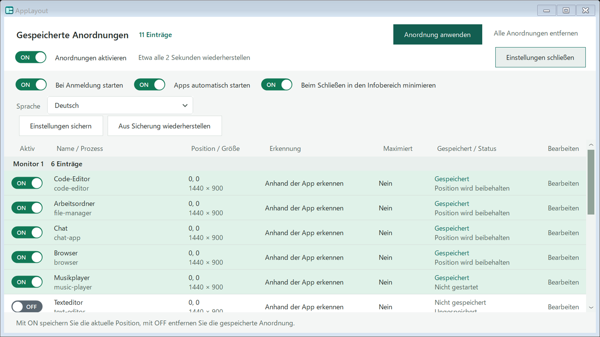
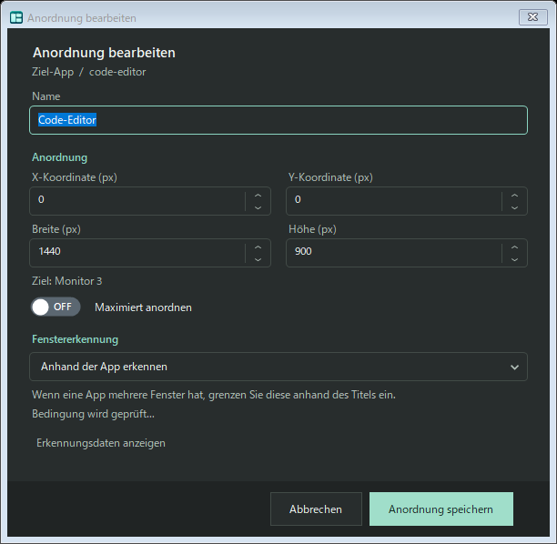

# AppLayout

[日本語](README.md) · [English](README.en.md) · [简体中文](README.zh-Hans.md) · [繁體中文](README.zh-Hant.md) · [한국어](README.ko.md) · [Español](README.es.md) · [Français](README.fr.md) · **Deutsch** · [Português (Brasil)](README.pt.md)

AppLayout speichert die Position und Größe von Windows-Fenstern und stellt gespeicherte Layouts wieder her. Mehrere Monitore und maximierte Fenster werden unterstützt.

## Download

[Neueste Version von GitHub Releases herunterladen](https://github.com/nekomimiyks/AppLayout/releases/latest)

Führen Sie `AppLayout-Setup.exe` aus und öffnen Sie AppLayout über das Startmenü. Einstellungen können als JSON-Datei gesichert und wiederhergestellt werden.

## Erste Schritte

1. Verschieben und skalieren Sie das gewünschte Fenster.
2. Schalten Sie die entsprechende Zeile in AppLayout auf **ON**, um das Layout zu speichern.
3. Klicken Sie auf **Anordnung anwenden**, um die gespeicherte Anordnung wiederherzustellen. Lassen Sie **Anordnungen aktivieren** eingeschaltet, damit dies automatisch geschieht.

Schalten Sie die Zeile auf **OFF**, um das gespeicherte Layout zu entfernen. Über **Bearbeiten** passen Sie Koordinaten oder die Zuordnungsregel an. Über **Einstellungen öffnen** ändern Sie die Anzeigesprache.

## Einstellungen sichern und wiederherstellen

Öffnen Sie auf dem alten PC die Einstellungen und sichern Sie sie als JSON-Datei. Kopieren Sie die Datei auf den neuen PC und wählen Sie **Aus Sicherung wiederherstellen**. Prüfen Sie die Bildschirme, bevor Sie die automatische Anordnung wieder aktivieren.

## Screenshots






## Aus dem Quellcode erstellen

Führen Sie den folgenden Befehl in PowerShell unter Windows aus. Der .NET-Framework-Compiler von Windows erzeugt `AppLayout.exe`.

```powershell
powershell -NoProfile -ExecutionPolicy Bypass -File .\build.ps1
```

## Lizenz

[MIT License](LICENSE) · [Datenschutzerklärung](docs/PRIVACY.md)
