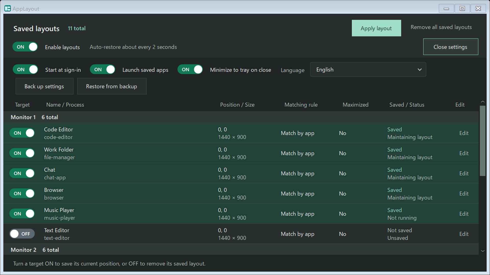
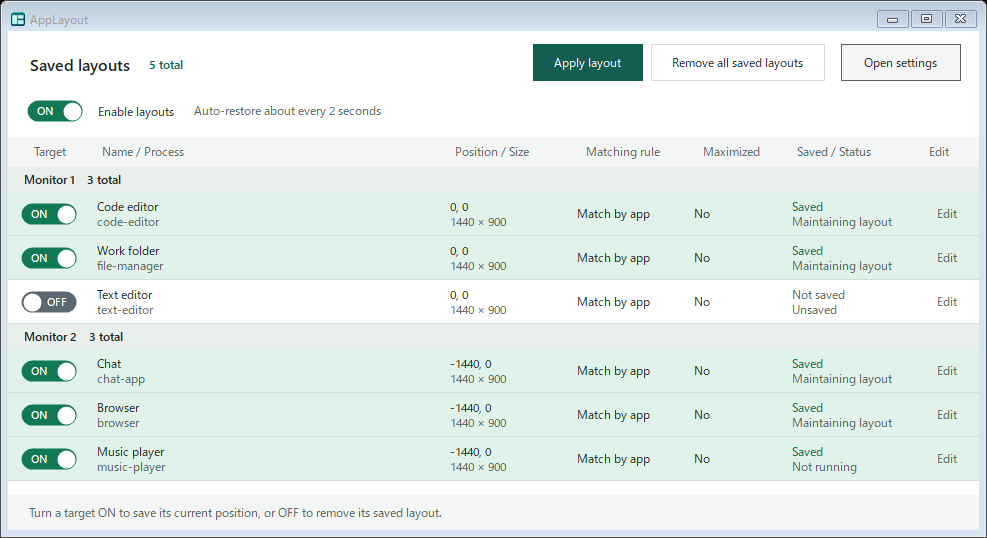
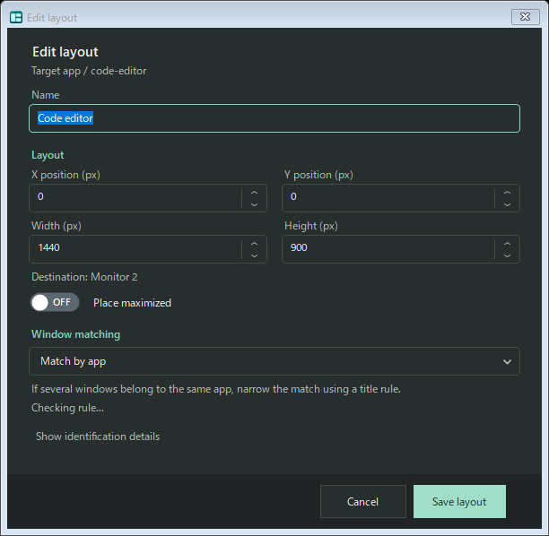
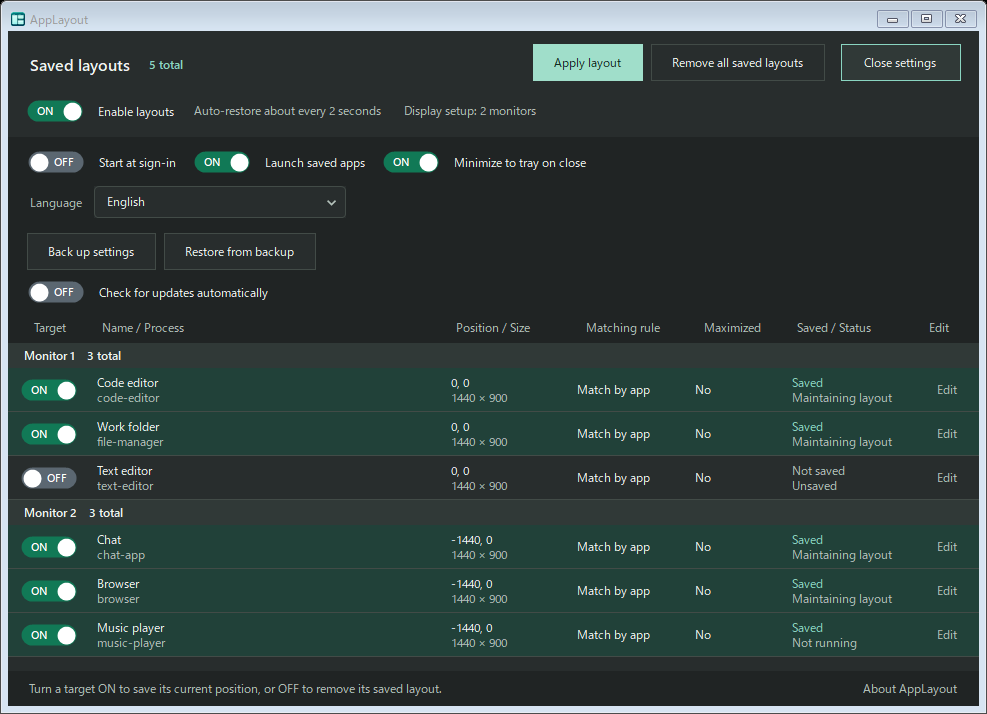

# AppLayout

[日本語](README.md) · **English** · [简体中文](README.zh-Hans.md) · [繁體中文](README.zh-Hant.md) · [한국어](README.ko.md) · [Español](README.es.md) · [Français](README.fr.md) · [Deutsch](README.de.md) · [Português (Brasil)](README.pt.md)

AppLayout saves the position and size of Windows application windows and restores your saved layouts. It supports multiple monitors and maximized windows.

## Download

[Download the latest release](https://github.com/nekomimiyks/AppLayout/releases/latest)

Run `AppLayout-Setup.exe`, then open AppLayout from the Start menu. Use **Back up settings** and **Restore from backup** to migrate your settings as a JSON file.
The installer can create a desktop shortcut. Turn on automatic update checks in settings to get notified about new GitHub releases. The update button starts the installer.

## Getting started

1. Move and resize the window you want to save.
2. Turn its row **ON** in AppLayout to save the layout.
3. Click **Apply layout** to restore the saved positions. Keep **Enable layouts** on for automatic restoration.

Turn a row **OFF** to remove its saved layout. Use **Edit** to adjust the position or matching rule, and select **Open settings** to choose the display language.

Save layouts separately for each display setup. After connecting or disconnecting a monitor, wait for the display setup to update, arrange your windows, and turn the relevant rows **ON**. AppLayout selects those saved layouts when the same setup returns. Automatic restoration follows **Enable layouts**. Backups include all setups. Existing layouts move to the first setup detected after upgrading.

## Back up and restore settings

On the old PC, open settings and choose **Back up settings**. Copy the JSON file to the new PC and select **Restore from backup**. Check the monitor layout before turning automatic layout back on.

## Screenshots









## Build from source

Run the following command in PowerShell on Windows. The Windows .NET Framework compiler generates `AppLayout.exe`.

```powershell
powershell -NoProfile -ExecutionPolicy Bypass -File .\build.ps1
```

## License

[MIT License](LICENSE) · [Privacy Policy](docs/PRIVACY.md)
