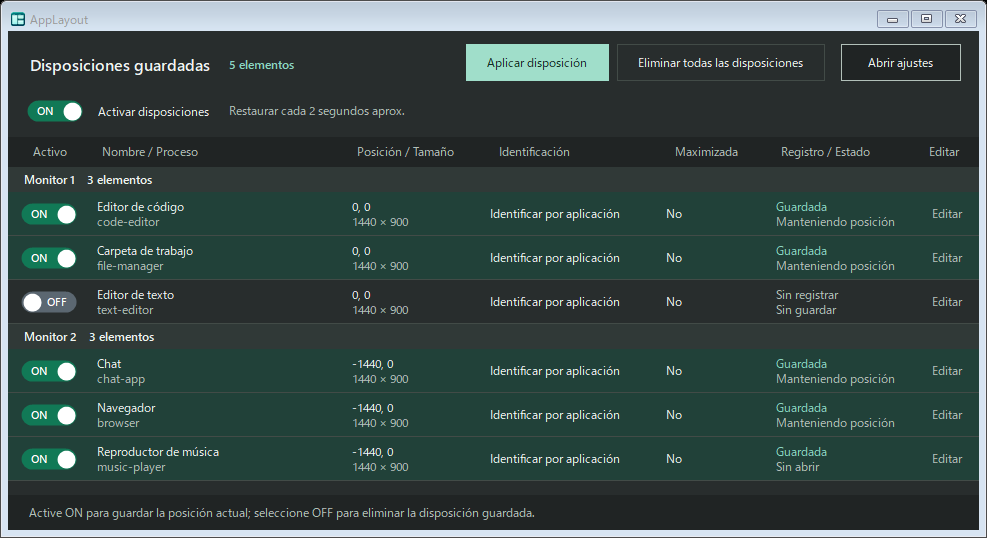
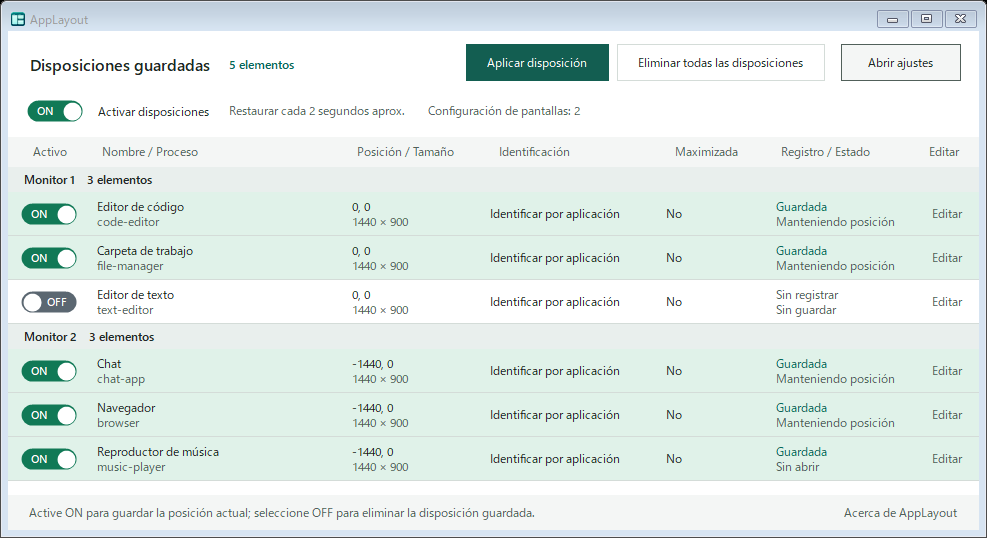
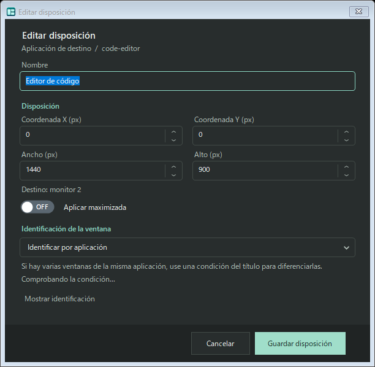
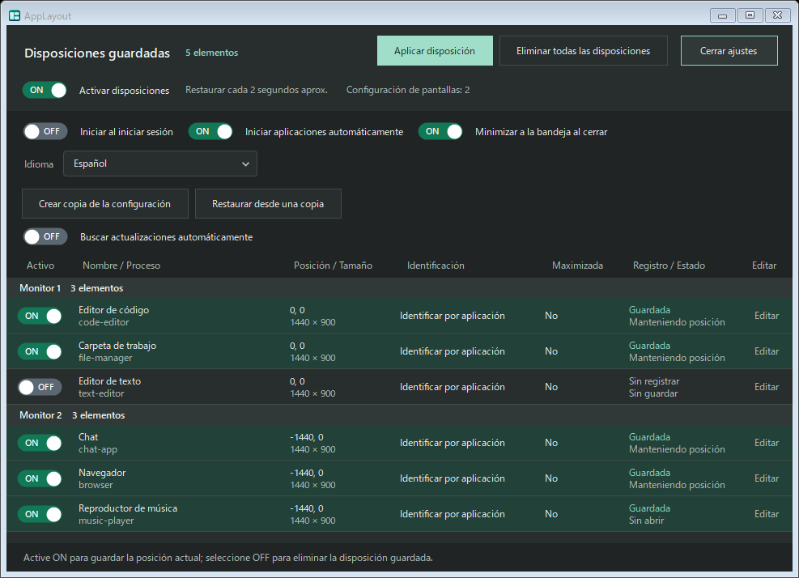
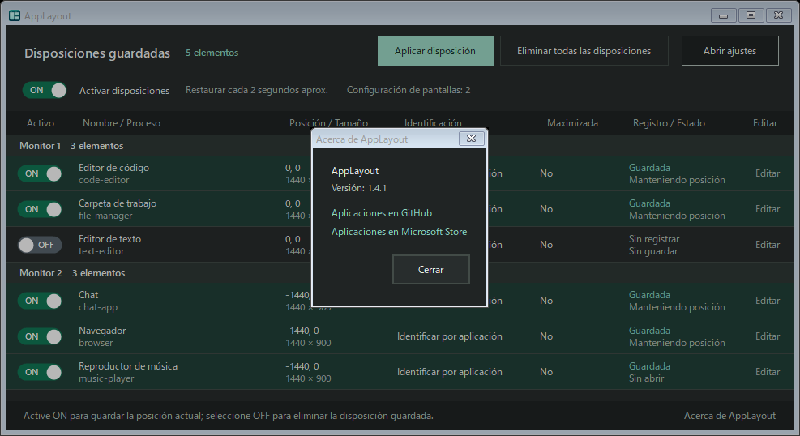

# AppLayout

[日本語](README.md) · [English](README.en.md) · [简体中文](README.zh-Hans.md) · [繁體中文](README.zh-Hant.md) · [한국어](README.ko.md) · **Español** · [Français](README.fr.md) · [Deutsch](README.de.md) · [Português (Brasil)](README.pt.md)

AppLayout guarda la posición y el tamaño de las ventanas de Windows y restaura la disposición guardada. Es compatible con varios monitores y ventanas maximizadas.

## Descarga

[Descargar la última versión de GitHub Releases](https://github.com/nekomimiyks/AppLayout/releases/latest)

Ejecuta `AppLayout-Setup.exe` y abre AppLayout desde el menú Inicio. Guarda y restaura la configuración con un archivo JSON.
El instalador puede crear un acceso directo en el escritorio. Activa la búsqueda automática de actualizaciones en los ajustes para recibir avisos de nuevas versiones de GitHub. El botón de actualización inicia el instalador.

## Primeros pasos

1. Mueve y redimensiona la ventana que quieres guardar.
2. Activa su fila (**ON**) en AppLayout para guardar la disposición.
3. Pulsa **Aplicar disposición** para restaurar la posición guardada. Mantén **Activar disposiciones** encendido para que se restaure automáticamente.

Desactiva la fila (**OFF**) para eliminar su disposición guardada. Usa **Editar** para ajustar las coordenadas o la regla de identificación y pulsa **Abrir ajustes** para elegir el idioma.

Guarda disposiciones distintas para cada configuración de pantallas. Después de conectar o desconectar un monitor, espera a que se actualice la configuración, ordena las ventanas y activa las filas correspondientes. Al volver a la misma configuración, AppLayout selecciona sus disposiciones. La copia de seguridad incluye todas las configuraciones. Las disposiciones anteriores se asignan a la primera configuración detectada tras actualizar.

## Copia de seguridad y restauración

Abre la configuración en el PC anterior y guarda la copia en JSON. Copia el archivo al nuevo PC y selecciona **Restaurar desde una copia**. Revisa los monitores antes de reactivar la disposición automática.

## Capturas de pantalla









En la esquina inferior derecha, selecciona Acerca de AppLayout para ver la versión en uso y los enlaces a las aplicaciones del desarrollador. Si no se puede abrir la aplicación Microsoft Store, se abre el navegador predeterminado.



## Compilar desde el código fuente

Ejecuta el siguiente comando en PowerShell para Windows. El compilador de .NET Framework de Windows genera `AppLayout.exe`.

```powershell
powershell -NoProfile -ExecutionPolicy Bypass -File .\build.ps1
```

## Licencia

[MIT License](LICENSE) · [Política de privacidad](docs/PRIVACY.md)
