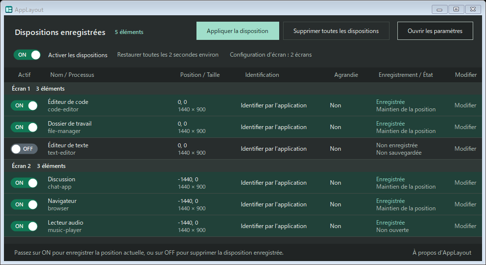
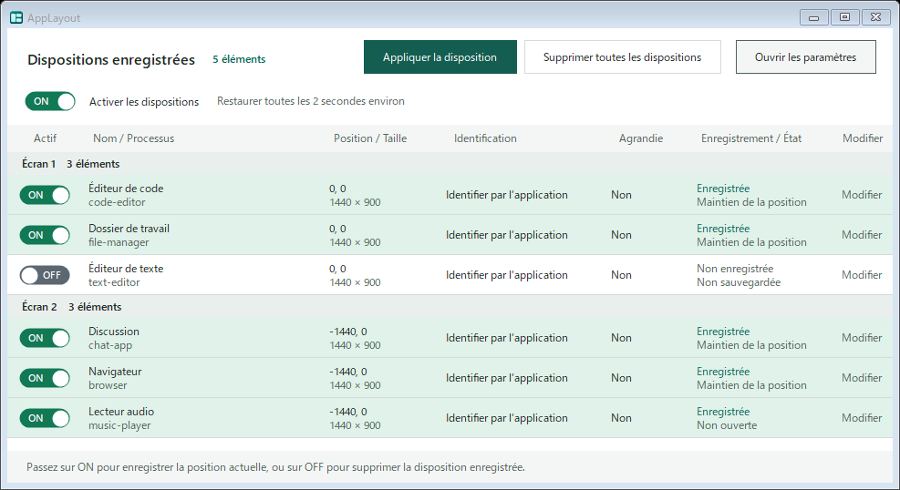
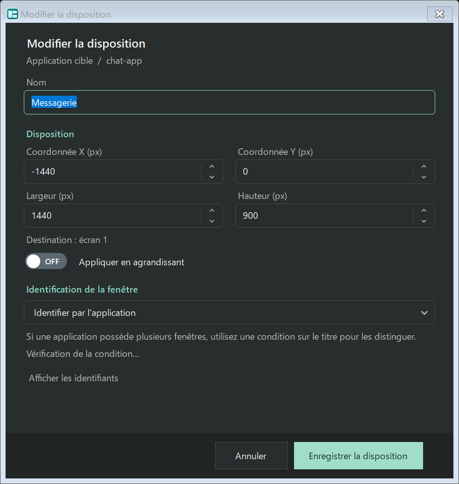

# AppLayout

[日本語](README.md) · [English](README.en.md) · [简体中文](README.zh-Hans.md) · [繁體中文](README.zh-Hant.md) · [한국어](README.ko.md) · [Español](README.es.md) · **Français** · [Deutsch](README.de.md) · [Português (Brasil)](README.pt.md)

AppLayout enregistre la position et la taille de vos fenêtres Windows et restaure la disposition enregistrée. Il prend en charge plusieurs moniteurs et les fenêtres agrandies.

## Téléchargement

[Télécharger la dernière version depuis GitHub Releases](https://github.com/nekomimiyks/AppLayout/releases/latest)

Extrayez l’archive ZIP, puis ouvrez `AppLayout.exe`.

## Premiers pas

1. Déplacez et redimensionnez la fenêtre à enregistrer.
2. Activez la ligne correspondante (**ON**) dans AppLayout pour enregistrer la disposition.
3. Cliquez sur **Appliquer la disposition** pour retrouver les positions enregistrées. Laissez **Activer les dispositions** activé pour que la restauration soit automatique.

Désactivez une ligne (**OFF**) pour supprimer sa disposition enregistrée. Utilisez **Modifier** pour ajuster les coordonnées ou la règle de correspondance, et sélectionnez **Ouvrir les paramètres** pour choisir la langue.

## Captures d’écran







## Compiler à partir du code source

Exécutez la commande suivante dans PowerShell sous Windows. Le compilateur .NET Framework de Windows génère `AppLayout.exe`.

```powershell
powershell -NoProfile -ExecutionPolicy Bypass -File .\build.ps1
```

## Licence

[MIT License](LICENSE) · [Politique de confidentialité](docs/PRIVACY.md)
