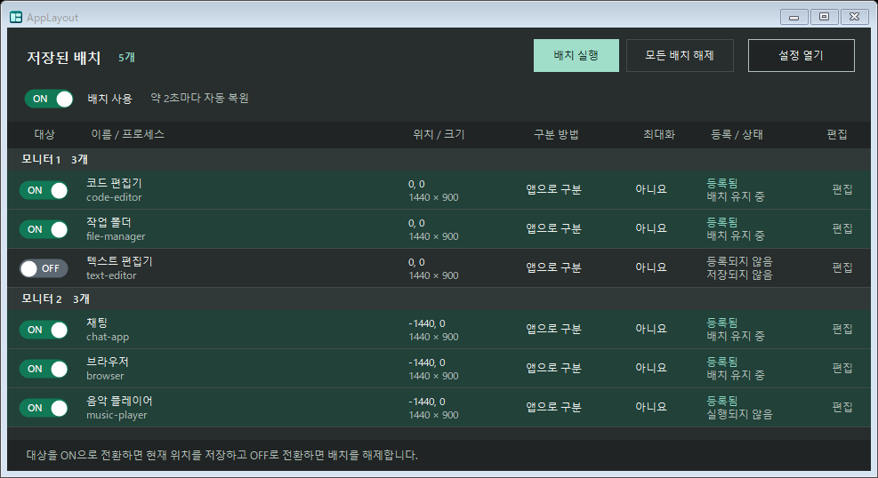
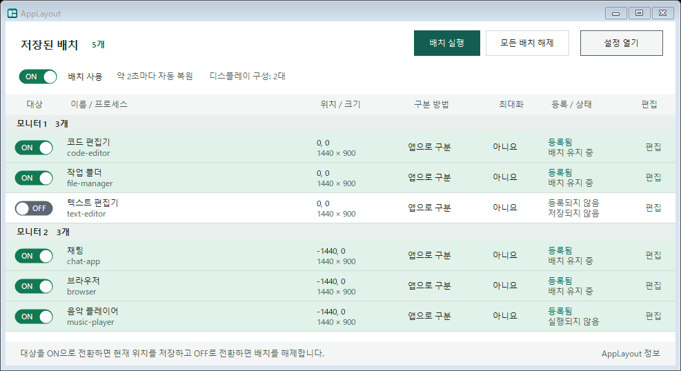
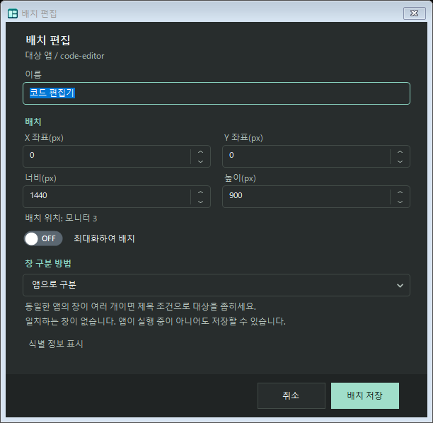

# AppLayout

[日本語](README.md) · [English](README.en.md) · [简体中文](README.zh-Hans.md) · [繁體中文](README.zh-Hant.md) · **한국어** · [Español](README.es.md) · [Français](README.fr.md) · [Deutsch](README.de.md) · [Português (Brasil)](README.pt.md)

AppLayout은 Windows 창의 위치와 크기를 저장하고 저장된 배치로 되돌리는 앱입니다. 여러 모니터와 최대화된 창을 지원합니다.

## 다운로드

[GitHub Releases에서 최신 버전 다운로드](https://github.com/nekomimiyks/AppLayout/releases/latest)

`AppLayout-Setup.exe`를 실행한 뒤 시작 메뉴에서 AppLayout을 엽니다. 설정은 JSON 파일로 백업하고 복원할 수 있습니다.

## 시작하기

1. 저장할 창을 원하는 위치로 옮기고 크기를 조절하세요.
2. AppLayout 목록에서 해당 행을 **ON**으로 전환하면 배치가 저장됩니다.
3. 「배치 실행」을 눌러 저장된 배치로 돌아갑니다. 「배치 사용」을 켜 두면 자동으로 복원됩니다.

해당 행을 **OFF**로 전환하면 등록이 해제됩니다. 「편집」에서 좌표나 창 일치 규칙을 바꾸고 「설정 열기」에서 표시 언어를 선택할 수 있습니다.

## 스크린샷







## 소스에서 빌드

Windows의 PowerShell에서 다음 명령을 실행하세요. Windows의 .NET Framework 컴파일러가 `AppLayout.exe`를 생성합니다.

```powershell
powershell -NoProfile -ExecutionPolicy Bypass -File .\build.ps1
```

## 라이선스

[MIT License](LICENSE) · [개인정보 처리방침](docs/PRIVACY.md)
