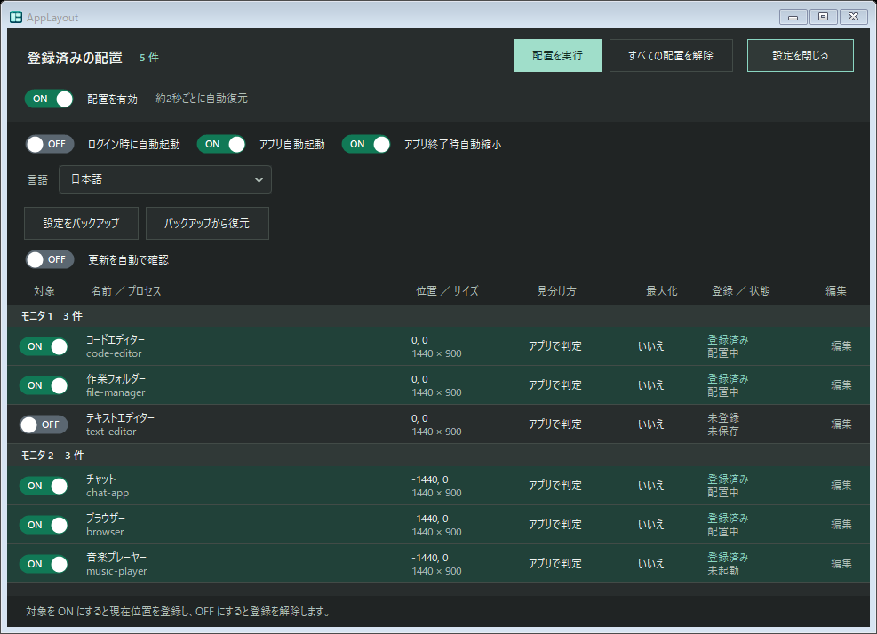
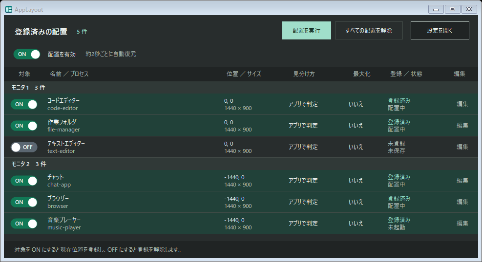
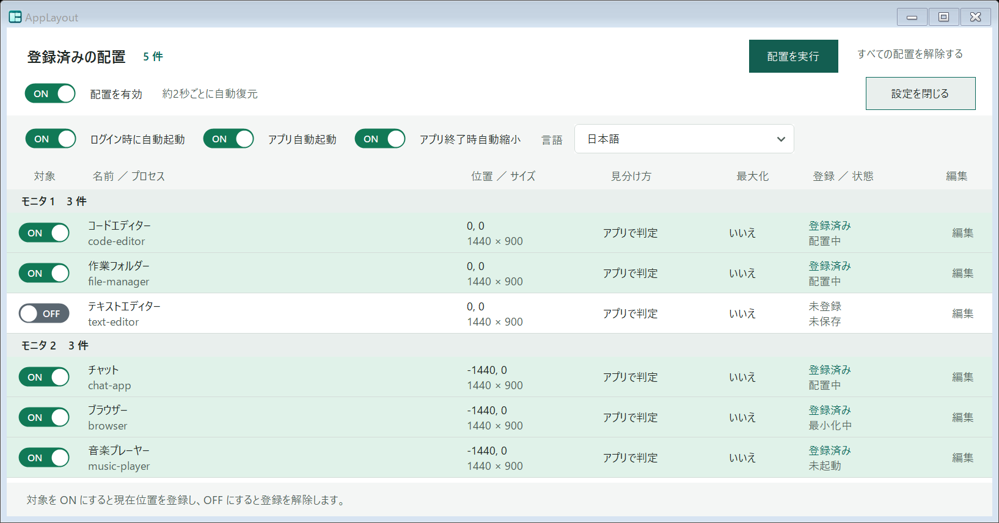
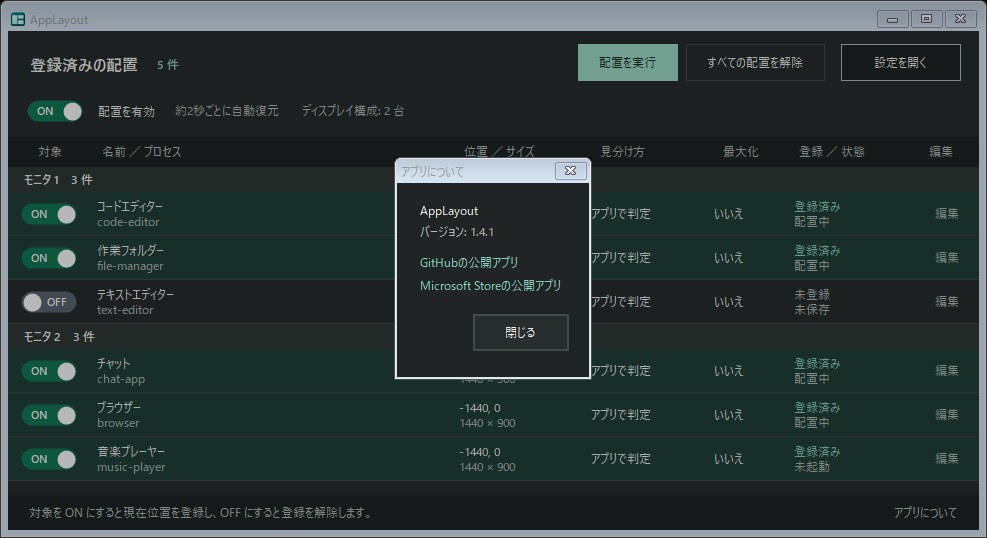

# AppLayout

**日本語** · [English](README.en.md) · [简体中文](README.zh-Hans.md) · [繁體中文](README.zh-Hant.md) · [한국어](README.ko.md) · [Español](README.es.md) · [Français](README.fr.md) · [Deutsch](README.de.md) · [Português (Brasil)](README.pt.md)

Windowsのウィンドウの位置とサイズを保存し、登録した配置に戻すアプリです。複数のモニターと最大化に対応しています。

## ダウンロード

[GitHub Releasesから最新版をダウンロード](https://github.com/nekomimiyks/AppLayout/releases/latest)

`AppLayout-Setup.exe` を実行します。インストールの「完了」を押すと、すぐに AppLayout を起動するか確認されます。「いいえ」を選んだ場合は、後でスタートメニューから開けます。

アップデートも同じ手順です。更新先のAppLayoutが起動中なら、インストーラーが終了させてから更新します。設定は引き継がれます。インストール時にデスクトップへのショートカットを作成できます。

GitHub版の「設定を開く」で「更新を自動で確認」をONにすると、新版が見つかったときに更新ボタンが表示されます。ボタンを押すとインストーラーが起動します。Microsoft Store版はStoreから更新されます。

## はじめての使い方

1. 保存したいウィンドウを希望の位置とサイズに動かします。
2. AppLayoutの一覧でその行を **ON** にすると配置が保存されます。
3. 「配置を実行」で保存した配置に戻します。「配置を有効」がONの間は自動で戻ります。

登録を解除するには行を **OFF** にします。全件を解除する場合は「すべての配置を解除」を選び、確認します。「編集」で座標やウィンドウの見分け方を変更できます。「設定を開く」から表示言語を切り替えられます。

ディスプレイの構成ごとに配置を保存できます。モニターを接続・切断して上部の「ディスプレイ構成」が更新されたら、各ウィンドウを並べて対象行を **ON** にします。同じ構成に戻ると、その構成の配置が選ばれます。「配置を有効」が **ON** の間は自動で戻ります。構成は台数・解像度・画面の並び・メイン画面で判定します。バックアップには全構成が含まれます。旧設定は、更新後に最初に確定した構成に引き継がれます。

## 設定のバックアップと復元

右上の **「設定を開く」** を押すと、バックアップと復元のボタンが表示されます。



1. 元のPCで **「設定をバックアップ」** を押し、JSONファイルを保存します。
2. USBメモリやOneDriveなどで、保存したJSONを新しいPCにコピーします。
3. 新しいPCで **「バックアップから復元」** を押し、JSONを選びます。確認画面の配置件数を確認し、**「はい」** を押します。
4. モニターとウィンドウの位置を確認してから、**「配置を有効」** をONにします。

復元すると現在の設定が置き換わり、直前の設定は `layout.json.before-restore` に保存されます。ログイン時の自動起動はWindowsユーザーごとの設定です。アプリの起動パスは移行されないため、自動起動させたいアプリの配置は新しいPCで登録し直してください。

## スクリーンショット






メイン画面の右下にある「アプリについて」から、実行中のバージョンと開発元の公開アプリ一覧を確認できます。Microsoft StoreのリンクはStoreアプリを優先し、開けない場合は既定のブラウザーで表示します。



## ソースからビルド

インストーラーを作る場合は、Inno Setup の `ISCC.exe` のパスを `-Compiler` に指定して `installer\pack.ps1 -Version 1.4.1 -OutDir .\dist` を実行します。

WindowsのPowerShellで次を実行します。Windowsの.NET Frameworkコンパイラで `AppLayout.exe` が生成されます。

```powershell
powershell -NoProfile -ExecutionPolicy Bypass -File .\build.ps1
```

## ライセンス

[MIT License](LICENSE) · [プライバシーポリシー](docs/PRIVACY.md)
