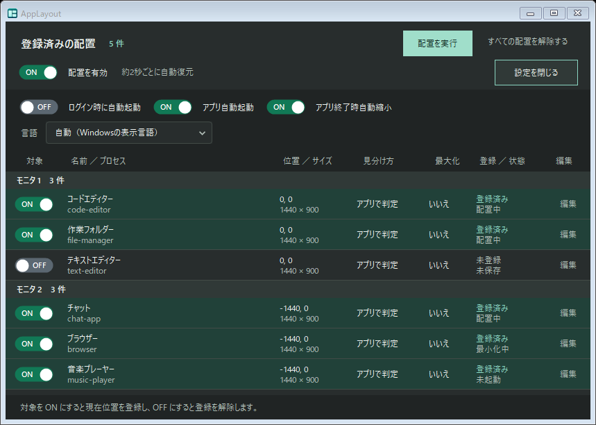
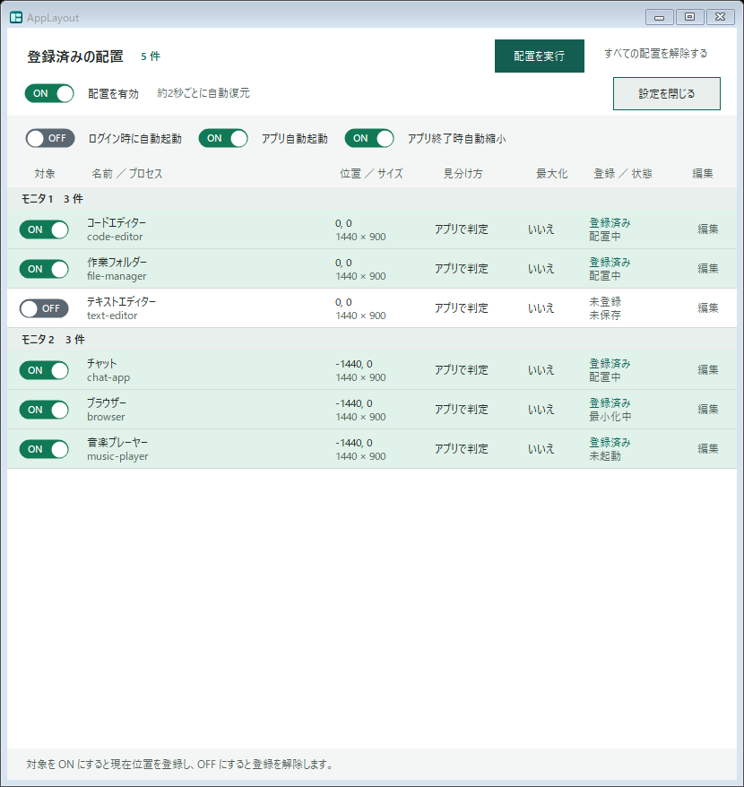
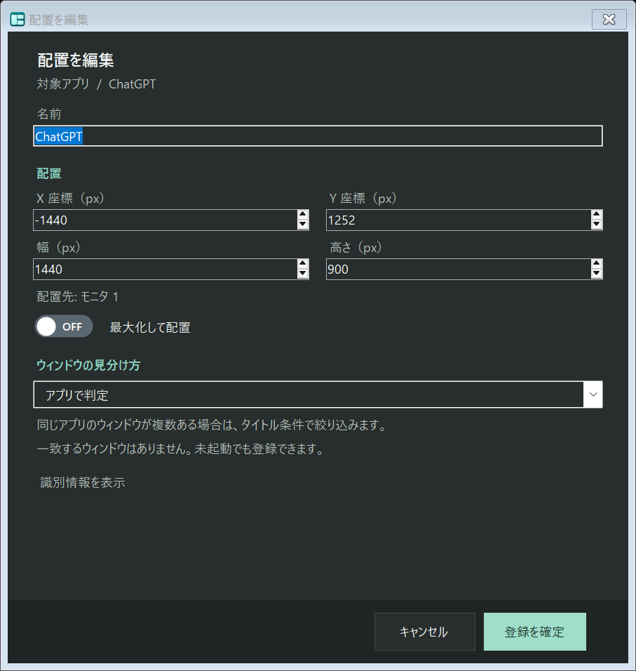

# AppLayout

Windowsのアプリの位置・サイズを登録し、保存した配置へ自動で戻す常駐アプリです。

- 行のON/OFFで配置を即時登録・解除
- モニタごとの一覧、配置の編集、全解除
- Windowsのライト／ダーク配色、文字サイズ、モニタごとのDPIに対応
- 専用スクロールバー、トレイメニュー、トレイ収納時のアニメーション
- 同じWindowsセッションでの多重起動を防止

## ダウンロード・起動

**[最新版をダウンロードする（GitHub Releases）](https://github.com/nekomimiyks/AppLayout/releases/latest)**

1. リリースページの **Assets** から `AppLayout-vX.Y.Z-Windows.zip` をダウンロードします。初回版は [AppLayout-v1.0.0-Windows.zip](https://github.com/nekomimiyks/AppLayout/releases/download/v1.0.0/AppLayout-v1.0.0-Windows.zip) です。
2. ZIPファイルを右クリックし、「すべて展開」で好きなフォルダへ展開します。
3. 展開したフォルダの `AppLayout.exe` をダブルクリックします。

インストールは不要です。Windowsと.NET Framework 4.xを使用します。ZIPを展開してから実行してください。GitHubへのログインは不要です。

実行ファイルだけ必要な場合は、リリースページの `AppLayout.exe` をダウンロードできます。`Source code (zip)` と `Source code (tar.gz)` は開発用のソースです。

## スクリーンショット

### メイン画面

モニタごとにアプリの配置を一覧表示します。対象をONにすると現在の位置・サイズを保存し、行全体の色で登録状態を確認できます。右上の「設定を開く」から自動起動などを設定できます。

#### ダーク配色



#### ライト配色



Windowsの配色に自動で合わせます。画像は一般名のアプリ名と架空のプロセス名を使ったサンプル表示です。特定の製品との提携や公式連携を示すものではありません。座標・件数は例で、表示サイズやタイトルバーの見た目はWindowsの設定により変わります。

### 配置の編集画面

各行の「編集」から、名前、位置・サイズ、最大化、ウィンドウの見分け方を変更できます。「登録を確定」で保存します。



## はじめての使い方

たとえば、ブラウザを左のモニタ、チャットアプリを右のモニタに固定したい場合は、次の手順で登録します。

1. 配置したいアプリを開き、希望の位置・サイズに調整します。
2. AppLayoutの一覧で、対象アプリの行またはスイッチをクリックして **ON** にします。
3. 現在の位置・サイズがその場で保存され、行全体の色が変わります。保存ボタンを押す必要はありません。
4. 「配置を有効」がONの間は、約2秒ごとに登録した配置へ自動で戻ります。

AppLayoutを起動したまま使います。最小化中やドラッグ中のウィンドウは移動しません。未登録のウィンドウをONにできない場合は、最小化を解除してから登録してください。

### 配置の変更・解除

| やりたいこと | 操作 |
| --- | --- |
| 保存した配置へすぐに戻す | 「配置を実行」をクリック |
| 位置・サイズを登録し直す | 対象をOFF → ウィンドウを移動・サイズ変更 → ON |
| 名前・見分け方・座標などを変更する | 行の「編集」を開き、変更後に「登録を確定」 |
| 1つのアプリの配置登録を解除する | 対象をOFFにする |
| すべての配置登録を解除する | 「すべての配置を解除する」をクリックし、確認する |

OFFにすると、そのアプリの配置登録が即座に解除されます。「すべての配置を解除する」を押しても、対象アプリ自体は閉じません。

### 常駐・終了・自動起動

- 最小化すると、タスクバー右端の通知領域（システムトレイ）に常駐します。アイコンが見えない場合は、通知領域の「隠れているインジケーターを表示」を開いてください。
- 画面を開き直すには、トレイアイコンを右クリックして「アプリを開く」を選びます。
- 完全に終了するには、トレイアイコンを右クリックして「アプリを終了する」を選びます。
- 右上の「設定を開く」から、ログイン時の自動起動や「アプリ終了時自動縮小」を変更できます。自動縮小がONの場合、画面の×を押してもトレイに常駐します。OFFの場合は終了します。

### 設定の保存・アップデート

配置設定は通常、`AppLayout.exe` と同じフォルダの `layout.json` に保存します。書き込めない場合は `%APPDATA%\AppLayout` に保存します。

アップデートするときは、トレイメニューからAppLayoutを終了し、使用中のフォルダの `AppLayout.exe` を新版に置き換えてください。`layout.json` を残すことで設定を引き継げます。

詳しい説明は [使い方.txt](使い方.txt)、動作の仕様は [仕様書](docs/仕様書.md) を参照してください。

## ビルド

Windows標準の.NET Framework 4.xコンパイラでビルドします。C# 5、WinFormsを使用し、NuGetは不要です。

```powershell
powershell -NoProfile -ExecutionPolicy Bypass -File .\build.ps1
```

既定の画面は `variants/Ledger`、共通処理は `src/core` にあります。旧画面案のソースは `variants` に保存しています。

## 検証

```powershell
powershell -NoProfile -ExecutionPolicy Bypass -File .\_dev\verification\run.ps1
```

専用の設定ファイルとテストウィンドウを使い、個人の配置設定を変更せずに確認します。
