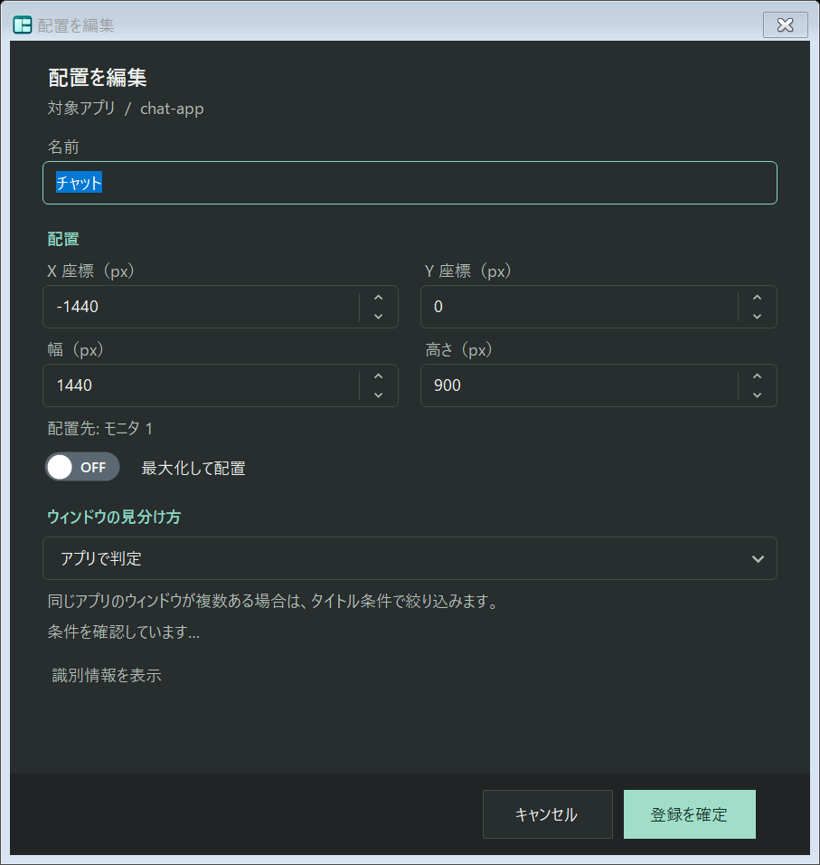

# AppLayout

**日本語** · [English](README.en.md) · [简体中文](README.zh-Hans.md) · [繁體中文](README.zh-Hant.md) · [한국어](README.ko.md) · [Español](README.es.md) · [Français](README.fr.md) · [Deutsch](README.de.md) · [Português (Brasil)](README.pt.md)

Windowsのウィンドウの位置とサイズを保存し、登録した配置に戻すアプリです。複数のモニターと最大化に対応しています。

## ダウンロード

[GitHub Releasesから最新版をダウンロード](https://github.com/nekomimiyks/AppLayout/releases/latest)

ZIPを展開して `AppLayout.exe` を開きます。

## はじめての使い方

1. 保存したいウィンドウを希望の位置とサイズに動かします。
2. AppLayoutの一覧でその行を **ON** にすると配置が保存されます。
3. 「配置を実行」で保存した配置に戻します。「配置を有効」がONの間は自動で戻ります。

登録を解除するには行を **OFF** にします。「編集」で座標やウィンドウの見分け方を変更できます。「設定を開く」から表示言語を切り替えられます。

## スクリーンショット




## ソースからビルド

WindowsのPowerShellで次を実行します。Windowsの.NET Frameworkコンパイラで `AppLayout.exe` が生成されます。

```powershell
powershell -NoProfile -ExecutionPolicy Bypass -File .\build.ps1
```

## ライセンス

[MIT License](LICENSE) · [プライバシーポリシー](docs/PRIVACY.md)
