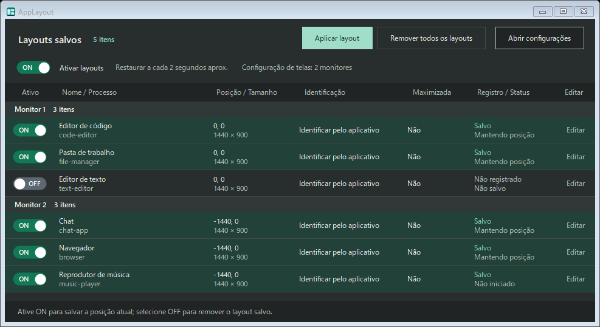
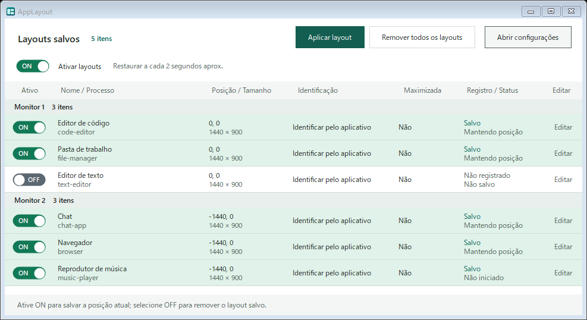
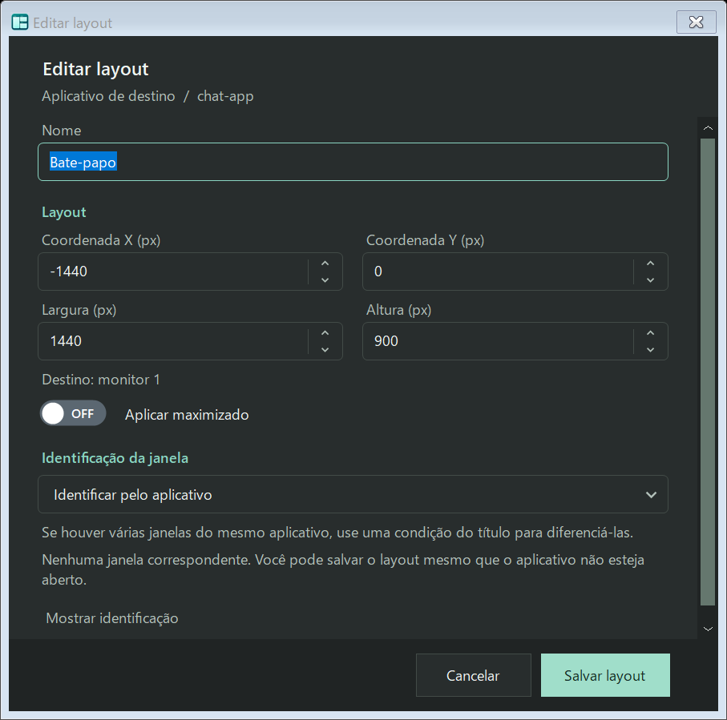
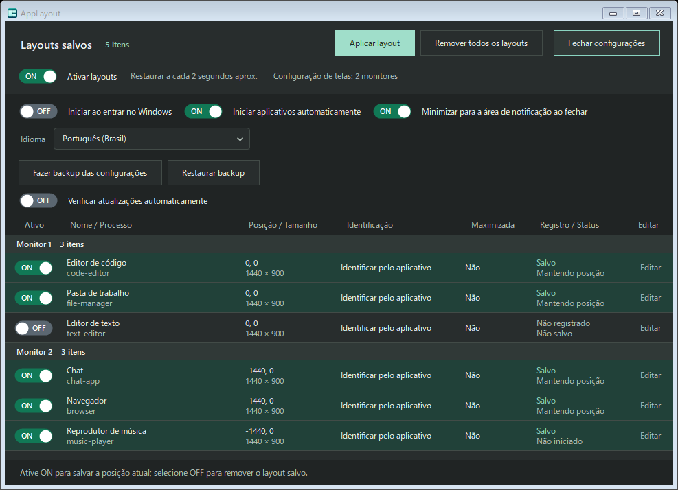
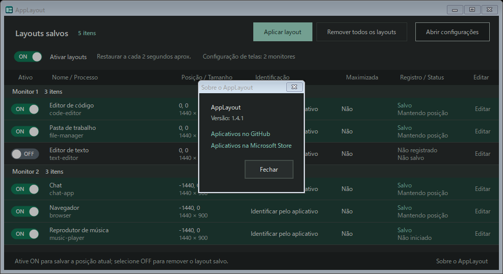

# AppLayout

[日本語](README.md) · [English](README.en.md) · [简体中文](README.zh-Hans.md) · [繁體中文](README.zh-Hant.md) · [한국어](README.ko.md) · [Español](README.es.md) · [Français](README.fr.md) · [Deutsch](README.de.md) · **Português (Brasil)**

O AppLayout salva a posição e o tamanho das janelas do Windows e restaura o layout salvo. O aplicativo oferece suporte a vários monitores e a janelas maximizadas.

## Download

[Baixar a versão mais recente no GitHub Releases](https://github.com/nekomimiyks/AppLayout/releases/latest)

Execute `AppLayout-Setup.exe` e abra o AppLayout pelo menu Iniciar. Faça backup e restaure as configurações com um arquivo JSON.
O instalador pode criar um atalho na área de trabalho. Ative a verificação automática de atualizações nas configurações para receber avisos sobre novas versões no GitHub. O botão de atualização abre o instalador.

## Primeiros passos

1. Mova e redimensione a janela que você deseja salvar.
2. Ative a linha correspondente (**ON**) no AppLayout para salvar o layout.
3. Clique em **Aplicar layout** para restaurar a disposição salva. Mantenha **Ativar layouts** ligado para restaurá-la automaticamente.

Desative a linha (**OFF**) para remover o layout salvo. Use **Editar** para ajustar as coordenadas ou a regra de correspondência e selecione **Abrir configurações** para escolher o idioma.

Salve layouts separados para cada configuração de telas. Depois de conectar ou desconectar um monitor, aguarde a atualização da configuração, organize as janelas e ative as linhas correspondentes. Ao voltar à mesma configuração, o AppLayout seleciona os layouts salvos. O backup inclui todas as configurações. Os layouts anteriores são associados à primeira configuração detectada após a atualização.

## Backup e restauração das configurações

No PC antigo, abra as configurações e faça um backup em JSON. Copie o arquivo para o novo PC e selecione **Restaurar backup**. Confira os monitores antes de reativar o layout automático.

## Capturas de tela









No canto inferior direito, abra Sobre o AppLayout para ver a versão em uso e os links para os aplicativos publicados. Se o aplicativo Microsoft Store não puder ser aberto, o link abrirá no navegador padrão.



## Compilar a partir do código-fonte

Execute o comando a seguir no PowerShell do Windows. O compilador do .NET Framework do Windows gera `AppLayout.exe`.

```powershell
powershell -NoProfile -ExecutionPolicy Bypass -File .\build.ps1
```

## Licença

[MIT License](LICENSE) · [Política de privacidade](docs/PRIVACY.md)
