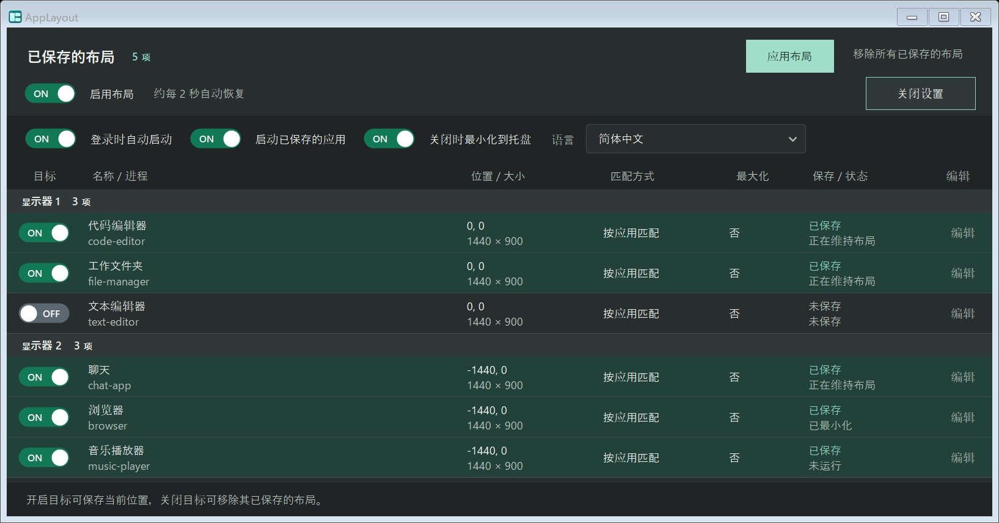
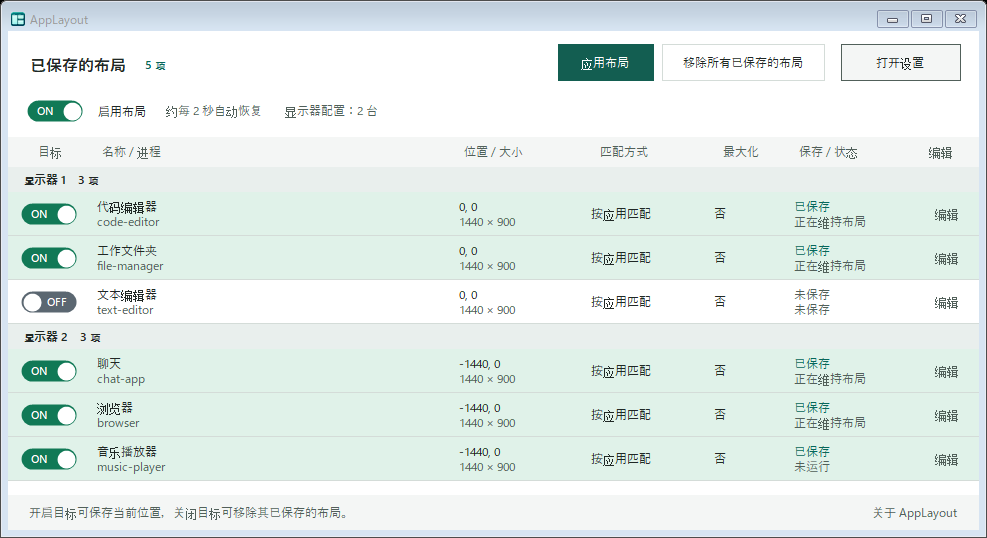
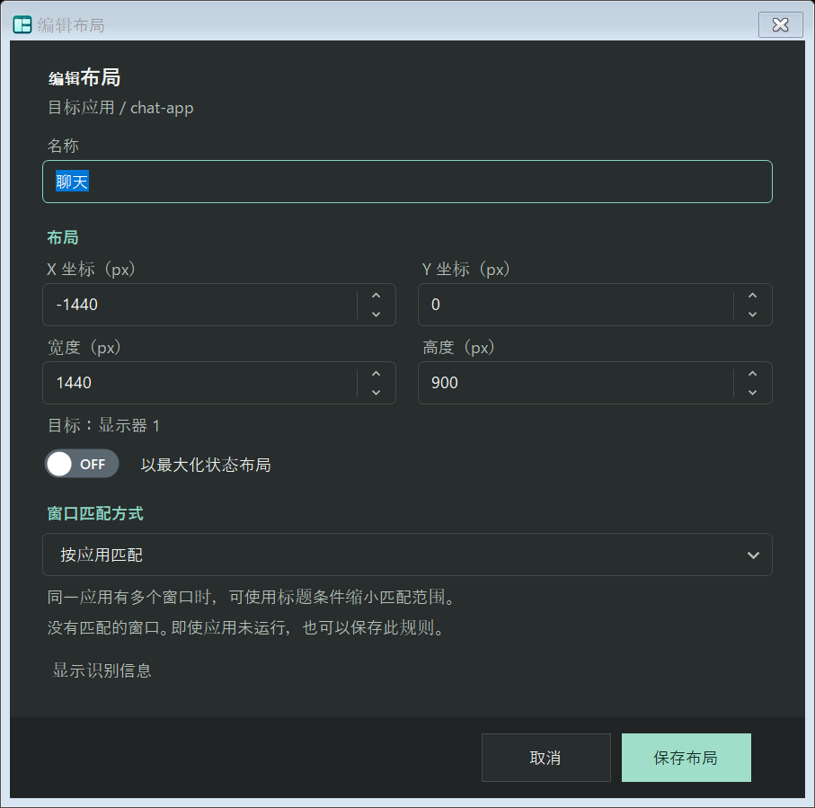

# AppLayout

[日本語](README.md) · [English](README.en.md) · **简体中文** · [繁體中文](README.zh-Hant.md) · [한국어](README.ko.md) · [Español](README.es.md) · [Français](README.fr.md) · [Deutsch](README.de.md) · [Português (Brasil)](README.pt.md)

AppLayout 可以保存 Windows 窗口的位置和大小，并将窗口恢复到已保存的布局。支持多显示器和最大化窗口。

## 下载

[从 GitHub Releases 下载最新版本](https://github.com/nekomimiyks/AppLayout/releases/latest)

运行 `AppLayout-Setup.exe` 安装，然后从开始菜单打开 AppLayout。设置可备份为 JSON 文件并还原。

## 快速开始

1. 将要保存的窗口移动到所需位置，并调整大小。
2. 在 AppLayout 的列表中将对应行设为 **ON**，即可保存布局。
3. 单击「应用布局」恢复已保存的布局。打开「启用布局」即可自动恢复。

将对应行设为 **OFF** 即可取消登记。使用「编辑」调整坐标或窗口匹配规则，「打开设置」即可切换显示语言。

## 备份和还原设置

在旧电脑上打开设置，选择**备份设置**并保存 JSON 文件。将文件复制到新电脑，选择**从备份还原**。重新启用自动布局前，请检查显示器。

## 界面截图







## 从源代码构建

在 Windows PowerShell 中运行以下命令。Windows 的 .NET Framework 编译器会生成 `AppLayout.exe`。

```powershell
powershell -NoProfile -ExecutionPolicy Bypass -File .\build.ps1
```

## 许可证

[MIT License](LICENSE) · [隐私政策](docs/PRIVACY.md)
