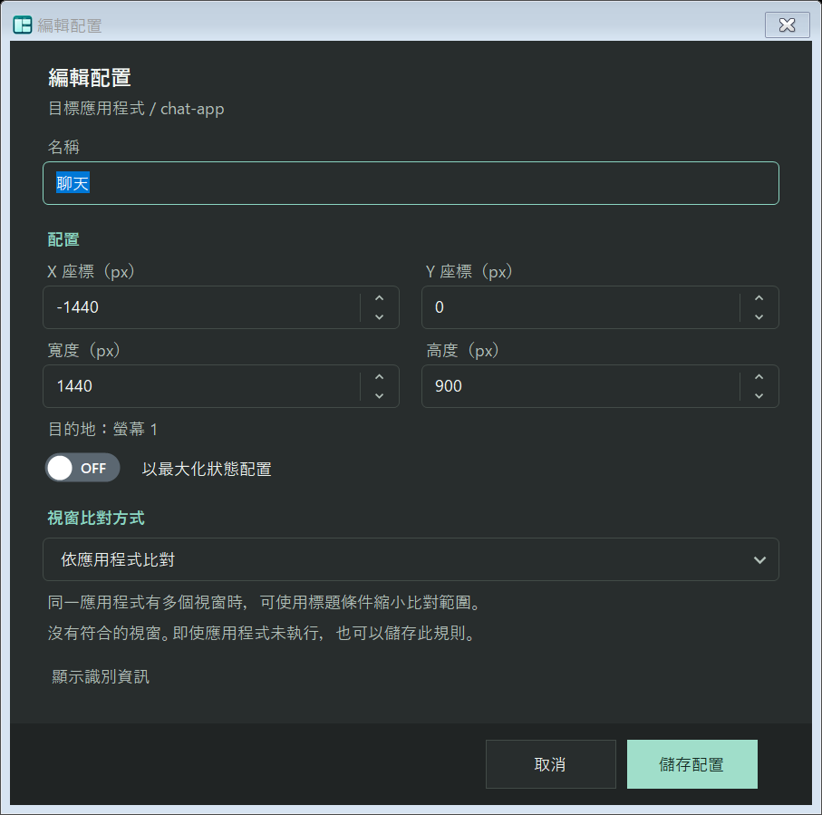

# AppLayout

[日本語](README.md) · [English](README.en.md) · [简体中文](README.zh-Hans.md) · **繁體中文** · [한국어](README.ko.md) · [Español](README.es.md) · [Français](README.fr.md) · [Deutsch](README.de.md) · [Português (Brasil)](README.pt.md)

AppLayout 可以儲存 Windows 視窗的位置和大小，並將視窗還原到已儲存的配置。支援多部顯示器和最大化視窗。

## 下載

[從 GitHub Releases 下載最新版本](https://github.com/nekomimiyks/AppLayout/releases/latest)

解壓縮 ZIP 檔案後，開啟 `AppLayout.exe`。

## 快速開始

1. 將要儲存的視窗移到所需位置，並調整大小。
2. 在 AppLayout 清單中將對應列切換為 **ON**，即可儲存配置。
3. 按一下「套用配置」還原已儲存的配置。開啟「啟用配置」即可自動還原。

將對應列切換為 **OFF** 即可取消登錄。使用「編輯」調整座標或視窗比對規則，「開啟設定」即可切換顯示語言。

## 介面截圖




## 從原始碼建置

在 Windows PowerShell 中執行下列命令。Windows 的 .NET Framework 編譯器會產生 `AppLayout.exe`。

```powershell
powershell -NoProfile -ExecutionPolicy Bypass -File .\build.ps1
```

## 授權條款

[MIT License](LICENSE) · [隱私權政策](docs/PRIVACY.md)
