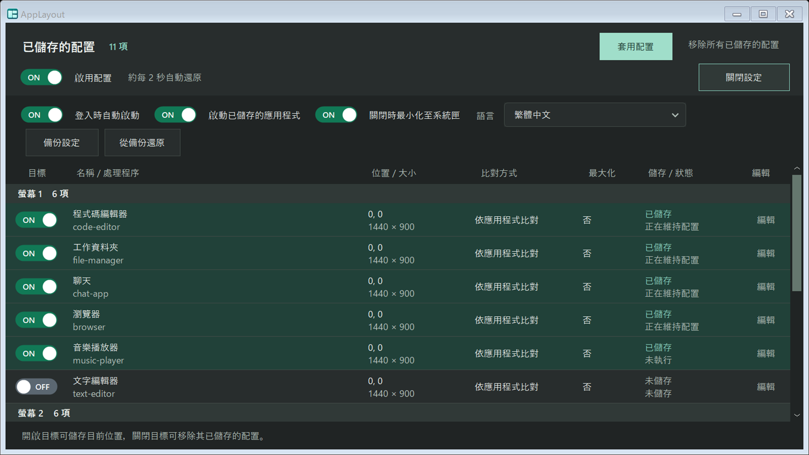
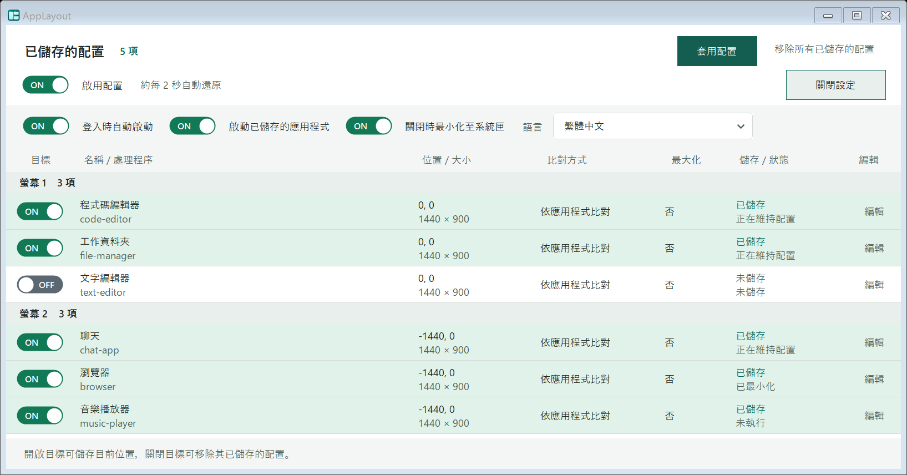
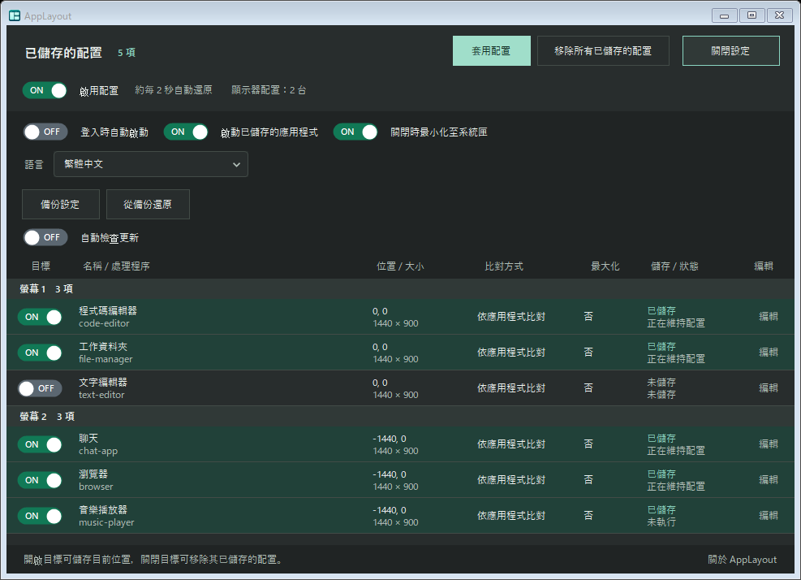
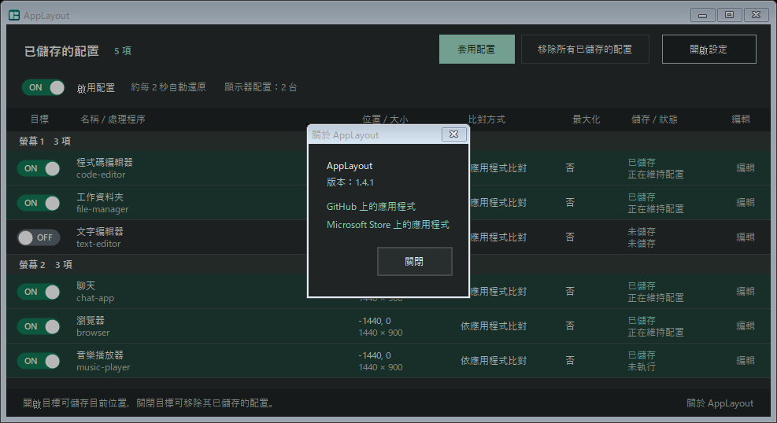

# AppLayout

[日本語](README.md) · [English](README.en.md) · [简体中文](README.zh-Hans.md) · **繁體中文** · [한국어](README.ko.md) · [Español](README.es.md) · [Français](README.fr.md) · [Deutsch](README.de.md) · [Português (Brasil)](README.pt.md)

AppLayout 可以儲存 Windows 視窗的位置和大小，並將視窗還原到已儲存的配置。支援多部顯示器和最大化視窗。

## 下載

[從 GitHub Releases 下載最新版本](https://github.com/nekomimiyks/AppLayout/releases/latest)

執行 `AppLayout-Setup.exe` 安裝，再從開始功能表開啟 AppLayout。設定可備份為 JSON 檔案並還原。
安裝程式可以建立桌面捷徑。在設定中開啟自動檢查更新，即可收到 GitHub 新版本通知。按下更新按鈕即可啟動安裝程式。

## 快速開始

1. 將要儲存的視窗移到所需位置，並調整大小。
2. 在 AppLayout 清單中將對應列切換為 **ON**，即可儲存配置。
3. 按一下「套用配置」還原已儲存的配置。開啟「啟用配置」即可自動還原。

將對應列切換為 **OFF** 即可取消登錄。使用「編輯」調整座標或視窗比對規則，「開啟設定」即可切換顯示語言。

可針對不同的顯示器配置分別儲存配置。連接或拔除顯示器後，請等待配置更新，再排列視窗並開啟對應列。回到相同的顯示器配置時，AppLayout 會選用對應的配置。備份包含所有顯示器配置。更新後，舊配置會移入首次偵測到的顯示器配置。

## 備份和還原設定

在舊電腦上開啟設定，選擇**備份設定**並儲存 JSON 檔案。將檔案複製到新電腦，選擇**從備份還原**。重新啟用自動配置前，請檢查螢幕。

## 介面截圖








點選主視窗右下角的「關於 AppLayout」即可查看目前版本及開發者發佈的應用程式。若無法開啟 Microsoft Store 應用程式，會在預設瀏覽器中開啟清單。



## 從原始碼建置

在 Windows PowerShell 中執行下列命令。Windows 的 .NET Framework 編譯器會產生 `AppLayout.exe`。

```powershell
powershell -NoProfile -ExecutionPolicy Bypass -File .\build.ps1
```

## 授權條款

[MIT License](LICENSE) · [隱私權政策](docs/PRIVACY.md)
